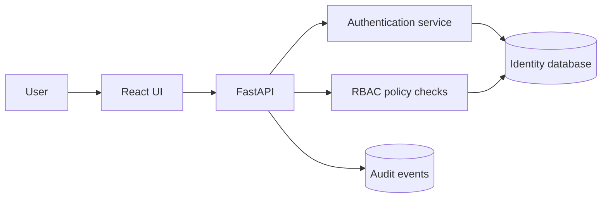

# Gatehouse IAM

Secure identity and access-management demo platform with authentication, role-based authorization, audit logging, and administrator workflows.

## Why this project exists
Gatehouse IAM turns classroom security concepts into a product-style system. It demonstrates the difference between authentication and authorization, applies least-privilege role checks to API routes, records security-relevant actions, and provides an admin view for managing access.

## Portfolio highlights
- React + TypeScript frontend and FastAPI backend
- Password hashing and signed JWT access tokens
- Role-based access control with `user`, `analyst`, and `admin` roles
- Server-side authorization checks on protected routes
- Immutable-style audit events for login and role-management actions
- Dockerized services and automated API tests

## Architecture


## Security model
| Role | Profile | Security dashboard | Manage roles | Audit log |
|---|---:|---:|---:|---:|
| user | ✓ | — | — | — |
| analyst | ✓ | ✓ | — | ✓ |
| admin | ✓ | ✓ | ✓ | ✓ |

## Run locally
### Backend
```bash
cd backend
python -m venv .venv
source .venv/bin/activate
pip install -r requirements.txt
uvicorn app.main:app --reload
```

### Frontend
```bash
cd frontend
npm install
npm run dev
```

The backend seeds three demo accounts on first launch:
- `user@example.com` / `User123!`
- `analyst@example.com` / `Analyst123!`
- `admin@example.com` / `Admin123!`

These credentials are intentionally demo-only and must never be used in a real deployment.

## API highlights
- `POST /api/auth/login`
- `GET /api/me`
- `GET /api/security/overview` — analyst/admin
- `GET /api/admin/users` — admin only
- `PATCH /api/admin/users/{id}/role` — admin only
- `GET /api/audit` — analyst/admin

## What I would add next
- Refresh-token rotation and revocation
- Email verification / password-reset flow
- TOTP or WebAuthn MFA
- OAuth 2.0 / OpenID Connect identity-provider integration
- Account lockout and configurable rate limiting
- PostgreSQL migration, SIEM export, and cloud deployment

## Resume-ready description
**Gatehouse IAM — Secure Identity & Access Platform**  
React • TypeScript • FastAPI • JWT • RBAC • SQL • Docker
- Built an identity platform implementing authentication, server-side role-based authorization, and protected administrator workflows.
- Added security audit events for authentication and privilege changes, giving analysts traceability into access-sensitive actions.
- Wrote authorization tests that verify users cannot access analyst/admin endpoints without the required role.
